# Petru FC

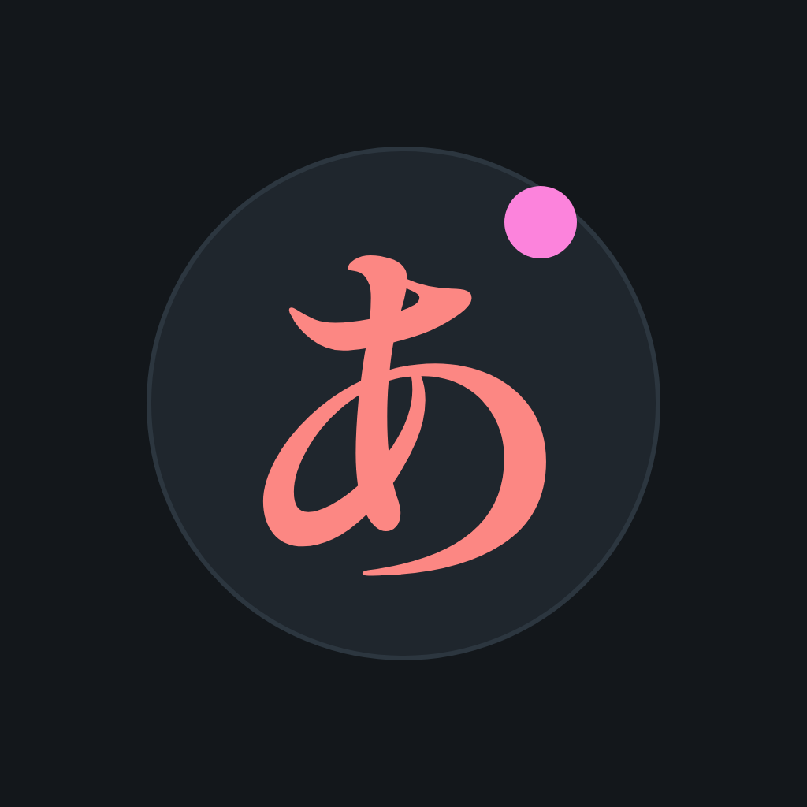

App Flutter para Android para estudiar japonés con flashcards. Incluye **Hiragana** y **Katakana** (mismas funciones en ambos) y está pensada para crecer (Kanji, etc.) a medida que avancen las clases. Funciona 100% sin conexión y se adapta al Galaxy Z Fold: vista **slab** (cerrado) y **extendida** (abierto).

## Funciones

Cada módulo (Hiragana y Katakana) ofrece las mismas cuatro funciones:

- **Flashcards**: Kana → Romaji y Romaji → Kana, con 4 opciones al azar y botón de pronunciación. Los sets (Básicos, Dakuten/handakuten, Combinados) se activan o desactivan a gusto.
- **Práctica**: se muestra el romaji, dibujas el carácter con el dedo y "Check" revela el correcto, muestra un porcentaje de parecido (comparación local con la fuente) y tú decides si lo lograste.
- **Vocabulario**: por secciones (Hiragana: "Partes del cuerpo" y "Órganos del cuerpo"; Katakana: "Comida y bebida", palabras de origen extranjero; 30 palabras por sección, solo con su propia escritura). Cada sección tiene una **Referencia** (palabra y significado), una **Práctica** en ambos sentidos (Palabra → Español y Español → Palabra) y una **Sopa de letras** de 8x8 con 8 palabras al azar, en 8 direcciones (incluidas las diagonales).
- **Referencia**: tabla con los 104 caracteres (46 básicos, 25 con dakuten/handakuten y 33 combinados) organizados por consonante y vocal; al tocar uno suena su pronunciación.
- Todas las respuestas se registran en SQLite (`review_stats`) para futuras estadísticas.

## Capturas

### Slab (Fold cerrado)

| Inicio | Menú Hiragana | Modo y sets | Tarjeta |
| :---: | :---: | :---: | :---: |
| 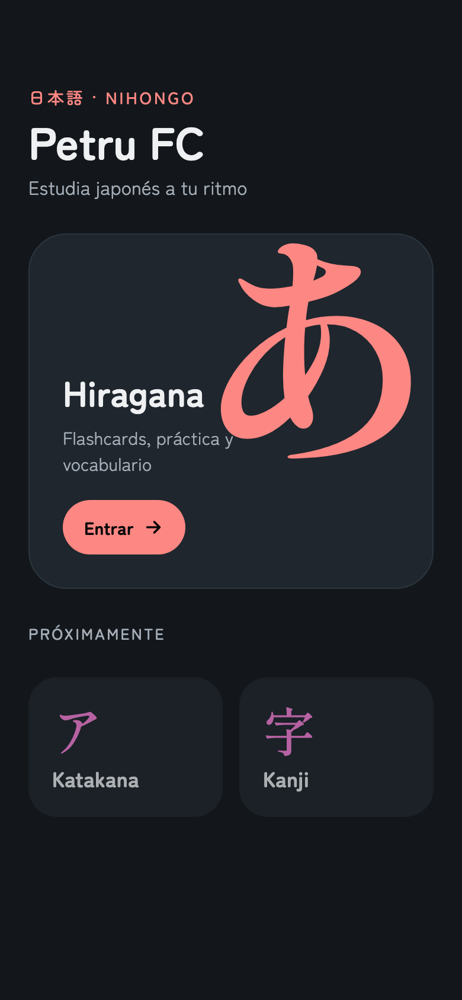 | 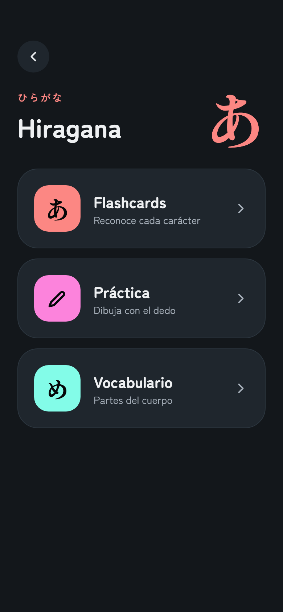 | 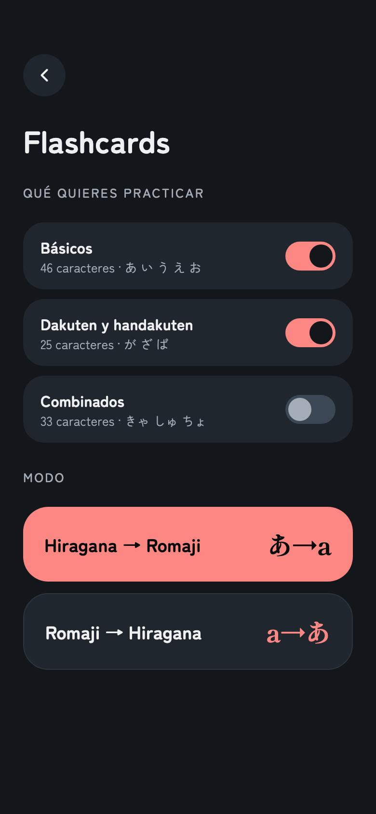 | 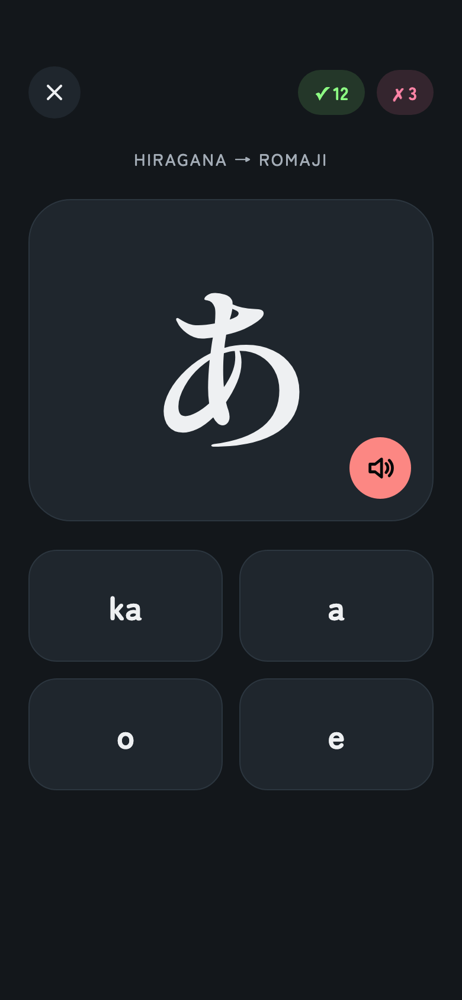 |

| Respuesta | Práctica | Práctica: Check | Vocabulario |
| :---: | :---: | :---: | :---: |
| 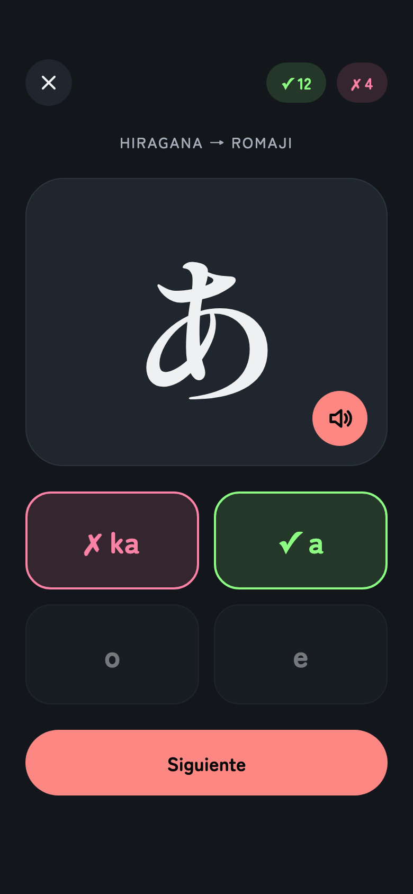 | 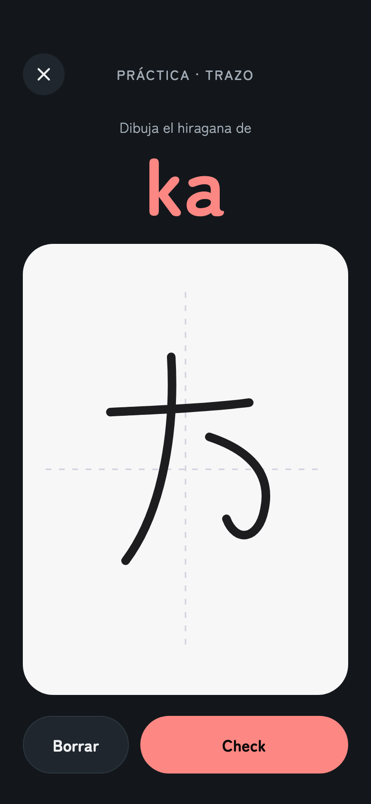 | 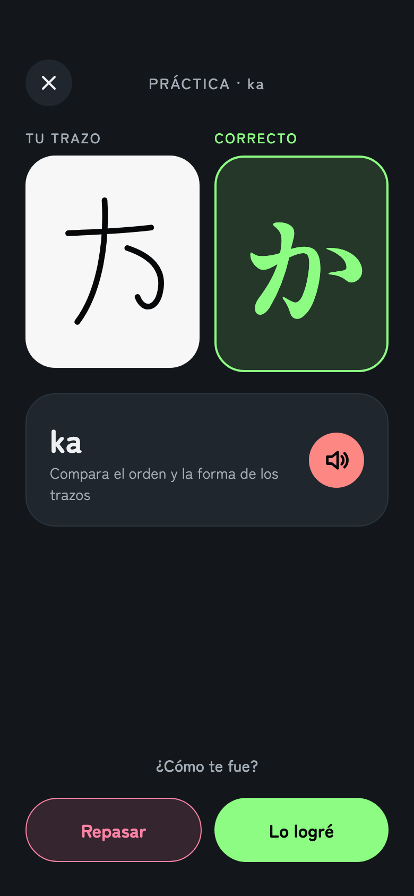 | 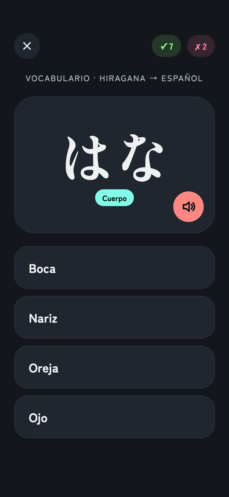 |

### Extendida (Fold abierto)

| Inicio + Menú | Modo y sets |
| :---: | :---: |
| 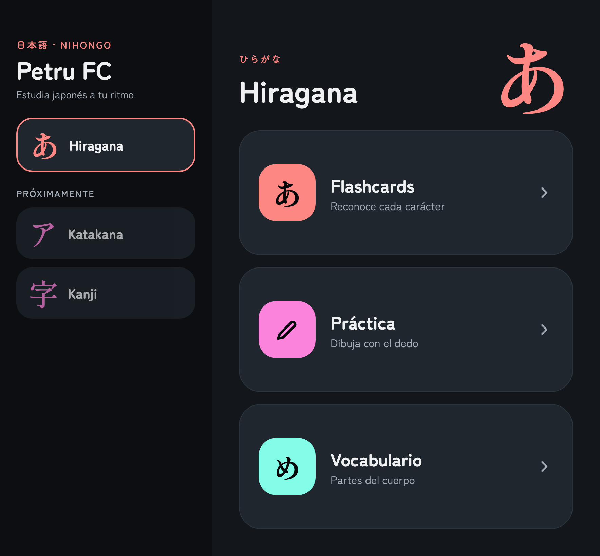 | 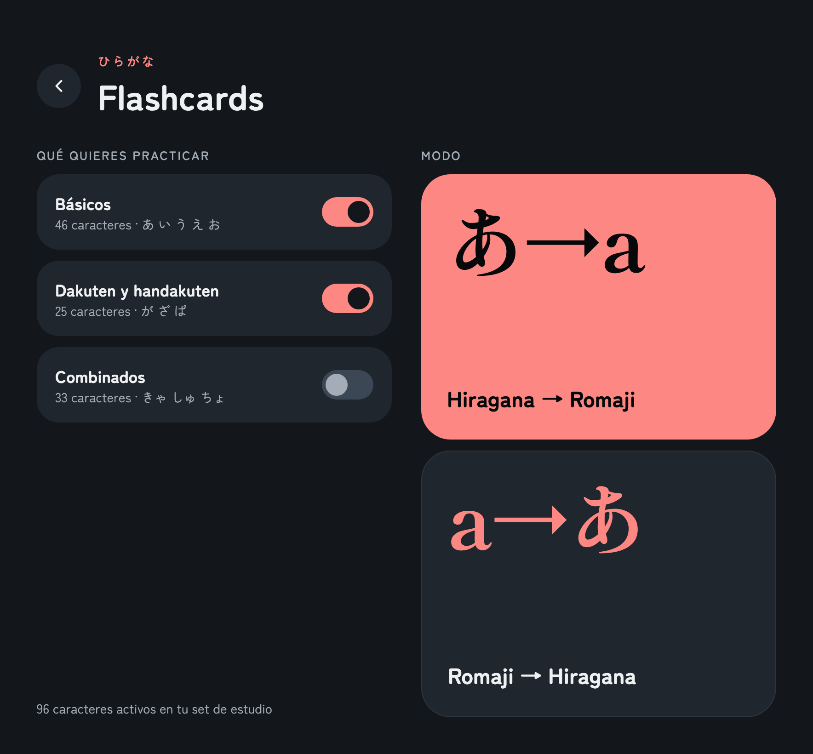 |

| Tarjeta y respuesta | Práctica y Check |
| :---: | :---: |
| 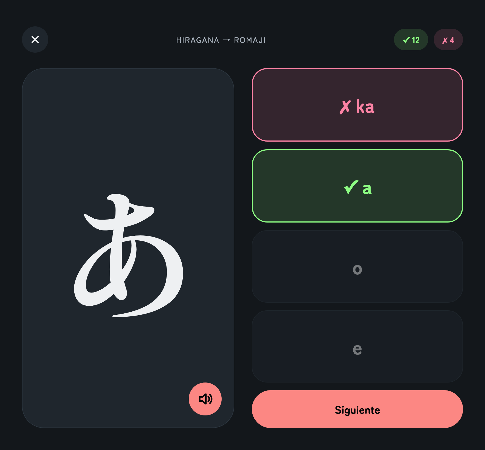 | 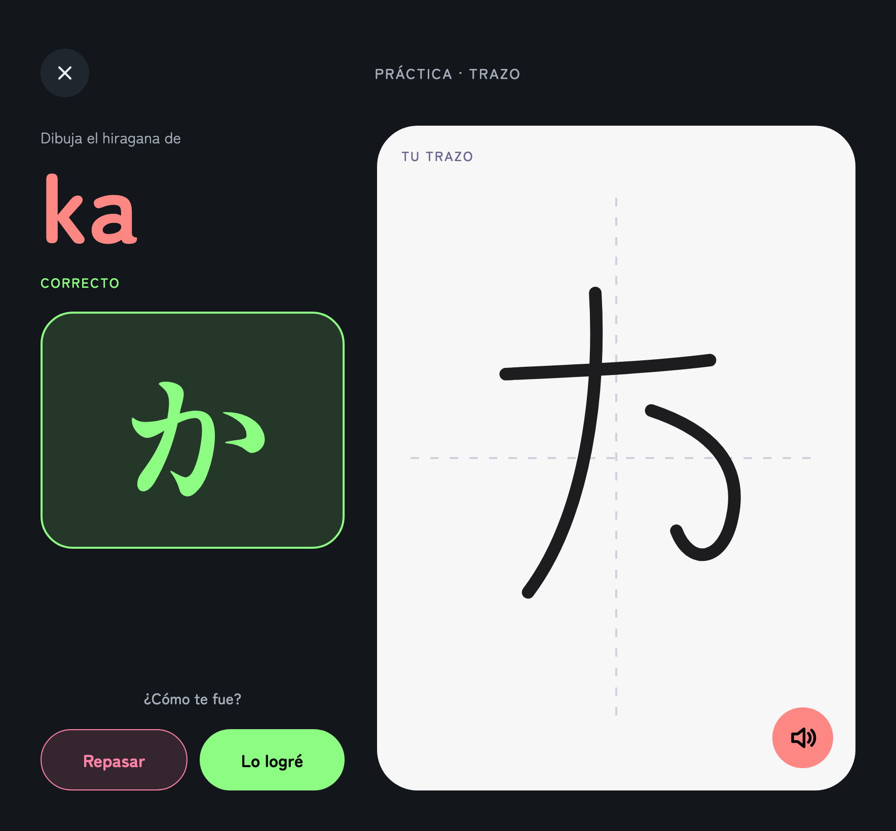 |

| Vocabulario |
| :---: |
| 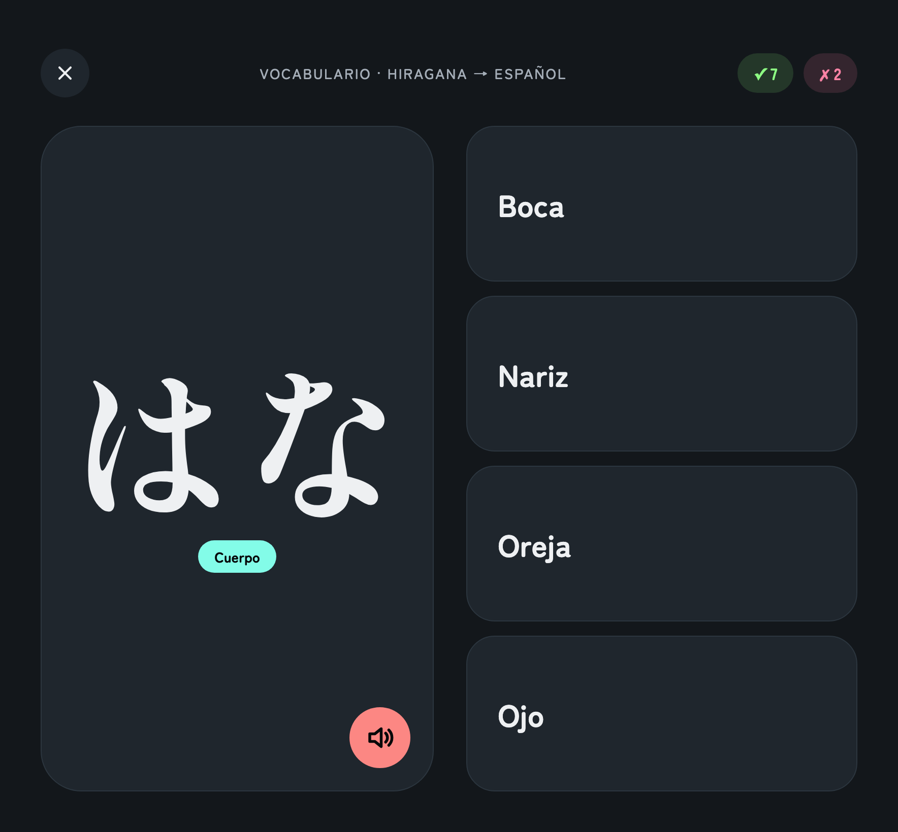 |

Las capturas salen de los mockups de diseño (tema PetruTheme Dark) y muestran Hiragana; Katakana, Referencia y las secciones de vocabulario usan los mismos componentes. Las dos disposiciones se eligen por ancho de ventana (corte en 600 dp) y cambian en vivo al plegar o desplegar.

## Stack

- Flutter, solo Android
- [Riverpod](https://riverpod.dev) 2.x (estado), [go_router](https://pub.dev/packages/go_router) (rutas)
- [Drift](https://drift.simonbinder.eu) + SQLite, con los datos sembrados desde código Dart
- `flutter_tts` para la voz japonesa (requiere la voz `ja-JP` de Google instalada en el teléfono)
- Fuentes empaquetadas: Zen Maru Gothic y Shippori Mincho

## Estructura

```
lib/
  app/        tema, router
  core/       datos (Drift), audio (TTS), layout, widgets compartidos
  features/   home, quiz (flashcards y vocabulario), practice, reference, vocabulary
```

## Desarrollo

```bash
flutter pub get
dart run build_runner build      # regenera lib/core/data/database.g.dart si cambia el esquema
flutter run
flutter build apk --release      # build/app/outputs/flutter-apk/app-release.apk
```

Requisitos: Flutter 3.35+, JDK compatible con Gradle 9.1 (el proyecto compila con JDK 25) y Android SDK 35+.

Para regenerar el ícono tras cambiar `assets/icon/`:

```bash
dart run flutter_launcher_icons
```

## Documentación

- [Diseño](docs/superpowers/specs/2026-10-12-petrufc-design.md)
- [Plan de implementación](docs/superpowers/plans/2026-10-12-petrufc.md)
